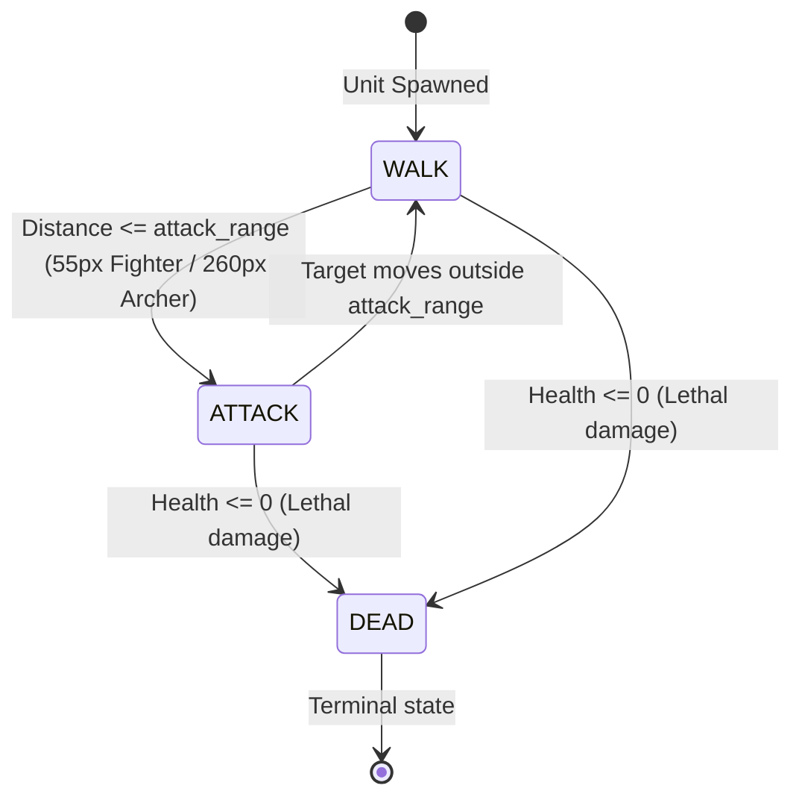

# Stickman Foundations

A lightweight, zero-dependency 2D stickman strategy combat foundation built with **Godot 4**.

Milestone 1 established the combat foundation. Milestone 2 added the economy and destructible base victory loop. **Milestone 3** introduces tactical unit choices with the melee **Fighter** and ranged **Archer**, procedural projectiles, dual training controls, and a deterministic enemy reinforcement mix.

> **Status Notice:** Godot 4.7.2 parses Milestone 3 successfully, all 200 headless smoke checks pass across 18 test suites, and the integrated main scene ran headlessly for 1,800 frames with exit code 0. Visual playtesting of the Archer vector presentation, arrow flight trajectories, dual training buttons, and combat pacing remains for the user. Android-device execution, rotation, memory profiling, and sustained frame pacing remain pending.

---

## Table of Contents
1. [Milestone 3 Scope & Overview](#milestone-3-scope--overview)
2. [Prerequisites & Project Configuration](#prerequisites--project-configuration)
3. [Verification Status & Evidence Levels](#verification-status--evidence-levels)
4. [How to Open & Run the Project](#how-to-open--run-the-project)
5. [Controls & Expected Battle Sequence](#controls--expected-battle-sequence)
6. [Architecture: Scenes & Scripts](#architecture-scenes--scripts)
7. [The Unit State Machine (FSM) & Combat Roles](#the-unit-state-machine-fsm--combat-roles)
8. [Gameplay Values & Stat Tuning](#gameplay-values--stat-tuning)
9. [Headless Smoke Test (Authored Suite)](#headless-smoke-test-authored-suite)
10. [Lightweight Design Principles](#lightweight-design-principles)
11. [Known Limitations & Pending Verification](#known-limitations--pending-verification)
12. [Next Milestones](#next-milestones)

---

## 1. Milestone 3 Scope & Overview

Milestone 3 introduces meaningful tactical decision-making while strictly preserving the lightweight-first philosophy:

- **Two Distinct Archetypes:**
  - **Fighter:** Durable frontline melee combatant dealing contact-timed punch damage.
  - **Archer:** Fragile ranged support unit shooting procedural arrows from safe distance.
- **Procedural Projectiles (`StickmanArrow`):**
  - Lightweight `Node2D` entity moving horizontally at 650 px/s with a 2.0s maximum lifetime.
  - Rendered with 2D vector primitives (cedar shaft, steel tip, team-colored fletching).
  - Damage is applied strictly on impact; harmlessly cleans itself up if its target dies or is freed in flight.
  - Preserves struck target across lethal damage callbacks.
- **Dual Training Controls:**
  - Separate **Train Fighter (25 Gold)** and **Train Archer (40 Gold)** buttons.
  - Independent disabling when gold is insufficient.
  - Shared strict cap of 6 living units per team across all archetypes.
- **Deterministic Red Reinforcements:**
  - Enemy base reinforces every 5.0 seconds in a predictable pattern: **Fighter, Fighter, Archer, Fighter, Fighter, Archer...**
  - Index advances only upon successful deployment and resets on restart.
- **Battle Victory & Projectile Cancellation:**
  - Destroying the enemy base proclaims victory, halts passive income, stops reinforcements, disables training buttons, ceases unit attacks, and cancels all active in-flight projectiles.
  - Late projectile impacts never overwrite the final winner announcement.
- **Full Battle Restart:**
  - Restores both bases to 500 HP and normal visual state.
  - Cancels and clears all projectiles from `ProjectileContainer`.
  - Restores initial 1 Blue Fighter and 1 Red Fighter, 25 gold, timers, and HUD cleanly.

---

## 2. Prerequisites & Project Configuration

- **Engine:** Godot 4 Standard (Godot 4.3+ / 4.7.x portable 64-bit Windows edition recommended).
- **Renderer:** GL Compatibility mode (`renderer/rendering_method="gl_compatibility"`, `renderer/rendering_method.mobile="gl_compatibility"`).
- **Viewport:** 1280x720 logical landscape (`window/stretch/mode="canvas_items"`, `window/stretch/aspect="expand"`).
- **Orientation:** Sensor landscape (`window/handheld/orientation=4`), allowing standard and reverse landscape while preventing portrait rotation.
- **Dependencies:** None. No C#, .NET, external art packs, audio libraries, or third-party plugins required.

---

## 3. Verification Status & Evidence Levels

To maintain rigorous technical transparency, project validation is categorized into three distinct evidence levels:

### Level 1: Confirmed File-Level Facts
- **Required Files:** Project configuration, scenes, scripts, and documentation exist in their expected locations.
- **Referenced Paths:** Scene files correctly reference controller scripts, unit archetypes, procedural renderers, and projectiles.
- **Configuration Values:** Verified that `project.godot` contains the exact intended renderer (`gl_compatibility`), mobile renderer (`gl_compatibility`), orientation (`4`), viewport (`1280x720`), and stretch settings (`canvas_items`, `expand`).
- **Formatting:** Clean whitespace with zero trailing whitespace or line-ending conflicts verified by `git diff --check`.

### Level 2: Custom Static Checks
- Node names verified: `%StatusLabel`, `%BlueHPLabel`, `%RedHPLabel`, `%RestartButton`, `%GoldLabel`, `%IncomeLabel`, `%TrainFighterButton`, `%TrainArcherButton`.
- Balanced GDScript delimiters and valid typing across all script files.

### Level 3: Godot Runtime Verification
- Godot 4.7.2 parser/import completed with exit code 0, registering global classes `StickmanUnit`, `StickmanVisual`, and `StickmanArrow`.
- The headless smoke suite passes all 200 checks across 18 test suites covering unit archetypes, arrow physics, dual training, shared unit caps, deterministic enemy spawning, base destruction, victory flow, and full restarts.
- The real main scene ran headlessly for 1,800 frames with exit code 0 and no runtime errors.
- Visual playtesting of Archer presentation, arrow trajectories, and button interaction remains for the user.
- Physical Android export testing, touch calibration, and memory profiling remain pending.

---

## 4. How to Open & Run the Project

### Installing Godot (if not yet installed)
1. Visit [godotengine.org/download](https://godotengine.org/download) and download **Godot Engine - Standard (Windows 64-bit)**.
2. Extract the portable executable (`Godot_v4.x.x-stable_win64.exe`) to any folder on your machine.
3. (Optional) Add that directory to your Windows `PATH` environment variable.

### Opening the Project
1. Launch Godot Engine.
2. In the Project Manager, click **Import**.
3. Click **Browse** and select `D:\PROJECTS\Game\project.godot`.
4. Click **Import & Edit**.

### Running the Battle
- Press **F5** (or click the **Play** button in the top-right corner of the editor).
- The main scene (`res://scenes/main.tscn`) will launch.

---

## 5. Controls & Expected Battle Sequence

### Controls
- **Train Fighter (25 Gold):** Spend 25 gold to deploy a frontline Blue Fighter. Disables when gold < 25 or at the 6-unit cap.
- **Train Archer (40 Gold):** Spend 40 gold to deploy a ranged Blue Archer. Disables when gold < 40 or at the 6-unit cap.
- **Restart Button:** Click "Restart Battle (R)" in the HUD.
- **Keyboard Shortcut:** Press **R** to restart at any time.

### Expected Battle Sequence
1. **Opening:** The battlefield begins with two procedural bases (500 HP each), 25 gold, one Blue Fighter, and one Red Fighter.
2. **First Choice:** The player can train an immediate second Fighter for 25 gold, or wait 3 seconds (+5 gold/sec) to train an Archer for 40 gold.
3. **Combat Roles:**
   - Fighters close to 55 px range, drawing enemy aggro and trading melee punches.
   - Archers halt at 260 px range behind the frontline, drawing bows and shooting arrows over distance.
4. **Targeting Dynamics:**
   - Both unit types prioritize living enemy units before bases.
   - When all enemy defenders are eliminated, surviving units advance toward and assault the enemy base.
   - If an enemy reinforcement spawns, attackers immediately retarget to the new defender.
   - In-flight arrows preserve their original target until impact.
5. **Enemy Wave Composition:** Red automatically reinforces every 5.0 seconds following **Fighter, Fighter, Archer, Fighter, Fighter, Archer...**
6. **Victory:** When either base reaches 0 HP, it collapses into ruins, active arrows cancel, and victory is proclaimed in the HUD.
7. **Restart:** Pressing `R` restores bases to 500 HP, cancels projectiles, resets the reinforcement sequence, and restores 1v1 starting rosters and 25 gold.

---

## 6. Architecture: Scenes & Scripts

```text
D:\PROJECTS\Game\
├── project.godot           # Project settings (1280x720, Compatibility, input mapping)
├── icon.svg                # Vector stickman project icon
├── .gitignore              # Ignores .godot/, exports, and temporary artifacts
├── README.md               # User guide and architectural walkthrough
├── docs/
│   ├── PROJECT_BRIEF.md    # High-level vision, rules, and deferred long-term systems
│   └── STATUS.md           # Engineering log, milestone verification, and test results
├── scenes/
│   ├── main.tscn           # Battlefield, instanced bases, ProjectileContainer, dual HUD
│   ├── base.tscn           # Reusable base scene (StickmanBase + StickmanBaseVisual)
│   ├── unit.tscn           # Reusable unit scene (StickmanUnit + StickmanVisual)
│   └── projectile.tscn     # Reusable arrow scene (StickmanArrow)
├── scripts/
│   ├── main.gd             # Economy, dual training, reinforcement mix, targeting, victory, restart
│   ├── base.gd             # Base combat logic: 500 HP, clamping, destroyed signal, combat anchor
│   ├── base_visual.gd      # Procedural base art, health bar, hit flash, ruined state
│   ├── unit.gd             # Unit combat logic, FSM, archetypes ("fighter", "archer"), ranged signals
│   ├── stickman_visual.gd  # Procedural vector drawing, bow, quiver, walk/punch/draw/death animations
│   └── projectile.gd       # Procedural StickmanArrow entity: delta travel, impact damage, cleanup
└── tests/
    └── smoke_test.gd       # Headless automated verification suite (200 tests)
```

---

## 7. The Unit State Machine (FSM) & Combat Roles

The 3-state finite state machine (`WALK`, `ATTACK`, `DEAD`) powers both archetypes seamlessly:



### Archetype Differences in ATTACK State:
- **Fighter:**
  - Range: 55 px.
  - Plays punch thrust animation.
  - Deals contact-timed melee punch damage at 50% animation progress.
- **Archer:**
  - Range: 260 px.
  - Plays bow draw-and-release animation.
  - At 50% progress, emits `ranged_shot_requested(attacker, target, damage)`.
  - Main spawns a `StickmanArrow` under `ProjectileContainer`.
  - Archer deals no melee damage; damage occurs strictly when the arrow reaches the target.

---

## 8. Gameplay Values & Stat Tuning

| Unit / Entity | Cost | HP | Speed | Range | Damage | Cooldown | Special Behavior |
| :--- | :---: | :---: | :---: | :---: | :---: | :---: | :--- |
| **Blue Fighter** | 25g | 100 | 90 px/s | 55 px | 15 | 0.7s | Contact punch at 50% anim |
| **Red Fighter** | — | 100 | 90 px/s | 55 px | 12 | 0.7s | Contact punch at 50% anim |
| **Blue Archer** | 40g | 60 | 70 px/s | 260 px | 10 | 1.2s | Emits arrow shot at 50% anim |
| **Red Archer** | — | 60 | 70 px/s | 260 px | 9 | 1.2s | Emits arrow shot at 50% anim |
| **StickmanArrow** | — | — | 650 px/s | — | Matches | 2.0s max | Delta travel, impact damage |
| **Bases (Both)** | — | 500 | — | — | — | — | Outer combat anchor at 50 px |

---

## 9. Headless Smoke Test (Authored Suite)

An automated headless smoke test suite is provided in [`tests/smoke_test.gd`](file:///D:/PROJECTS/Game/tests/smoke_test.gd).

> **Result:** All 200 checks pass under Godot 4.7.2.

### Running the Test:
```bash
godot --headless -s tests/smoke_test.gd
```

### Test Suites (200 Checks Total):
1. **Resource Loading (10 tests):** Verifies all scenes and scripts load.
2. **Unit Instantiation & Defaults (7 tests):** Confirms default stats and states.
3. **Damage Clamping (5 tests):** Confirms health reduction and non-negative clamping.
4. **Attack Contact Timing (7 tests):** Confirms contact-timed damage and target caching.
5. **Death State & Signal Safety (3 tests):** Confirms transition to `DEAD` and single signal emission.
6. **Dead Unit Invariance (3 tests):** Proves dead units ignore damage and cannot leave `DEAD`.
7. **Two-Unit Combat Simulation (6 tests):** Simulates 60 FPS duel until victory.
8. **Economy & Reinforcement Loop (18 tests):** Validates gold, income intervals, enemy timer, caps, and resets.
9. **Retargeting & Cleanup (7 tests):** Confirms survivors target enemy base, retarget defenders, and bodies are freed.
10. **Battle Scene Re-Instantiation & Restart (9 tests):** Confirms clean scene reset and state restoration.
11. **Base Entity & Combat Logic (11 tests):** Verifies base instantiation, 500 HP, clamping, and single destruction signal.
12. **Base Targeting & Positioning (8 tests):** Confirms units move to base, stop outside walls at 55 px, and apply contact damage.
13. **Base Destruction & Victory Condition (23 tests):** Verifies Blue and Red victory flows, disabled UI, winner-message protection, and restarts.
14. **Tactical Archetypes & Archer Mechanics (22 tests):** Validates Fighter vs Archer stats, visual binding, and shot requests without melee damage.
15. **Arrow Projectile Physics & Impact (12 tests):** Verifies delta travel, impact damage, duplicate damage prevention, target loss cleanup, and lifetime expiration.
16. **Tactical Economy & Dual Training (21 tests):** Validates 25g/40g costs, independent button disabling, and shared 6-unit cap.
17. **Deterministic Red Reinforcements (14 tests):** Proves Fighter, Fighter, Archer sequence and restart reset.
18. **Ranged Targeting, Base Assault & Victory (15 tests):** Tests archer targeting priority, ranged base assault, projectile victory, and restart projectile removal.

---

## 10. Lightweight Design Principles

- **Zero External Art:** Units, bows, arrows, bases, and health bars are drawn procedurally with canvas primitives.
- **No Physics Overhead:** No `RigidBody2D`, `CharacterBody2D`, or `CollisionShape2D` nodes. Movement and impact detection use simple delta math.
- **Inexpensive UI:** Responsive container layouts, default Godot vector fonts, and event-driven label updates.
- **Minimal Footprint:** Total project code and scenes remain under 95 KB, far below the 500 KB milestone limit.

---

## 11. Known Limitations & Pending Verification

- **Visual Verification Pending:** Visually inspect Archer bow, quiver, drawing animation, arrow flight, dual buttons, and Red reinforcement sequence.
- **Android Verification Pending:** Physical device testing for touch responsiveness, sustained 60 FPS frame pacing, and landscape rotation.
- **Memory Profiling Pending:** Automated runs completed without observed errors, but formal memory profiling remains pending.

---

## 12. Next Milestones

- Physical Android device build and touch validation.
- Additional tactical archetypes (e.g. Tank/Shieldman, Cavalry).
- Optional visual enhancements (projectile trail particles, subtle hit sparks).
